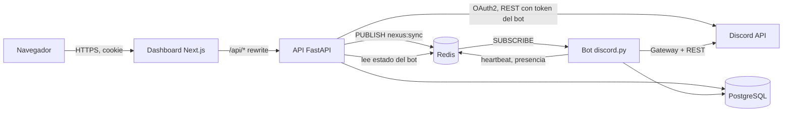
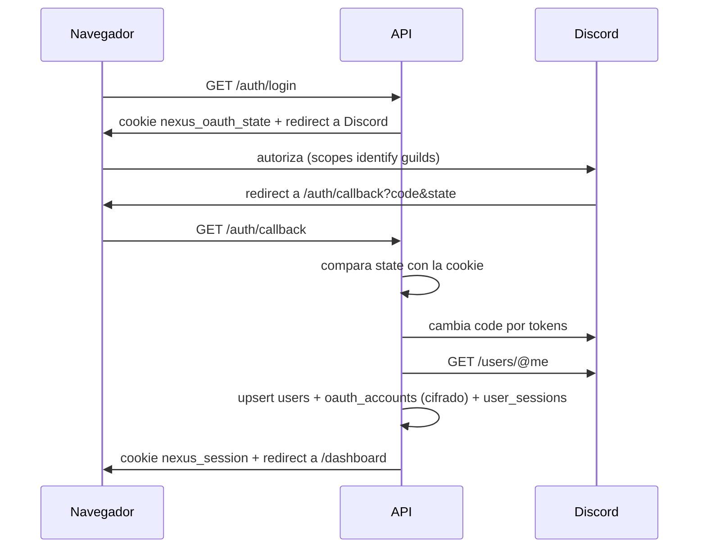

# NEXUS BOT — Especificación de la API y la sincronización

API: **FastAPI** en `http://127.0.0.1:8000`, prefijo `/api/v1`.
El dashboard la usa a través de un rewrite de Next.js (`localhost:3000/api/*` → `127.0.0.1:8000/api/*`), así que para el navegador todo es el mismo origen.

---

## 1. Arquitectura



Reglas:

1. **PostgreSQL es la fuente de verdad.** Redis solo avisa y guarda caché; si se borra, no se pierde nada.
2. **El token del bot vive solo en el backend** (API y bot), nunca en el dashboard ni en el navegador.
3. **Toda petición que toca un servidor verifica permisos en la API.** Ocultar un botón no protege nada.
4. El dashboard y el bot son independientes: si uno se cae, el otro sigue funcionando.

---

## 2. Variables de entorno

| Variable | Usada por | Ejemplo / notas |
|---|---|---|
| `ENV` | todos | `development` / `production` |
| `DATABASE_URL` | API, bot | `postgresql://nexus:…@127.0.0.1:5432/nexus` |
| `REDIS_URL` | API, bot | `redis://127.0.0.1:6379/0` |
| `DISCORD_CLIENT_ID` | API, dashboard | ID de la aplicación |
| `DISCORD_CLIENT_SECRET` | API | **Secreto** |
| `DISCORD_BOT_TOKEN` | API, bot | **Secreto** |
| `DISCORD_REDIRECT_URI` | API | `http://localhost:3000/api/v1/auth/callback` |
| `DASHBOARD_URL` | API | `http://localhost:3000` |
| `ENCRYPTION_KEY` | API, bot | Clave Fernet para tokens cifrados. **Secreto** |
| `DEV_GUILD_ID` | bot | Servidor de pruebas: los comandos slash se registran ahí al instante |

---

## 3. Autenticación (Discord OAuth2)



### Cookies

| Cookie | Contenido | Opciones |
|---|---|---|
| `nexus_session` | Token aleatorio de 32 bytes (en la base de datos solo su hash) | `HttpOnly`, `SameSite=Lax`, `Secure` en producción, `Path=/`, 30 días |
| `nexus_csrf` | Token aleatorio, legible por JavaScript | `SameSite=Lax`, `Secure` en producción |
| `nexus_oauth_state` | `state` + `next` (a dónde volver tras el login) | `HttpOnly`, 10 minutos |

### CSRF

Toda petición `POST`, `PUT`, `PATCH` o `DELETE` debe llevar la cabecera `X-CSRF-Token` con el valor de la cookie `nexus_csrf`. Si falta o no coincide, se responde `403 csrf_failed`. Junto con `SameSite=Lax`, esto bloquea peticiones falsas desde otras webs.

### Renovación de tokens de Discord

Si `oauth_accounts.expires_at` está a menos de 1 día, la API usa el refresh token antes de llamar a Discord. Si Discord lo rechaza (el usuario quitó el acceso), se revoca la sesión y se responde `401 reauth_required`.

---

## 4. Permisos

### 4.1. Acceso al dashboard de un servidor

Para cada petición a `/guilds/{guild_id}/…`, la dependencia `require_guild_access(level)` comprueba:

1. Sesión válida → si no, `401 unauthenticated`.
2. El usuario está en ese servidor según `/users/@me/guilds`. La lista se guarda en Redis 60 segundos (`nexus:user_guilds:{user_id}`) → si no, `404 guild_not_found`, para no revelar qué servidores existen.
3. Es el dueño, tiene `ADMINISTRATOR` (bit 3) o `MANAGE_GUILD` (bit 5) → acceso total.
4. **Fase 3:** si no, se buscan sus roles (REST con el token del bot, caché 60 s) en `dashboard_role_permissions` y se toma el nivel más alto para el módulo o para `*`.
5. Nivel insuficiente → `403 forbidden` con `{"required_level": 2}`.

| Nivel | Puede |
|---|---|
| 1 ver | `GET` |
| 2 editar | `PUT` / `PATCH` de configuración |
| 3 administrar | Activar o desactivar módulos, borrar, cambiar permisos |

### 4.2. Que el bot esté en el servidor

Los endpoints de configuración requieren `guilds.bot_present = true`. Si no, `409 bot_not_in_guild` con la URL de invitación.

### 4.3. Permisos del bot (diagnóstico)

`nexus_core.discord.permissions` calcula los permisos efectivos del bot en un canal: rol @everyone → roles del bot → overwrites del canal (everyone, roles, miembro). Se usa para:

- La página de diagnóstico (§6.4).
- Validar al guardar: si eliges un canal de bienvenida donde el bot no puede escribir, se guarda igual pero la respuesta incluye un **aviso** (`warnings`).
- Jerarquía de roles (fase 4): avisar si un rol está por encima del rol más alto del bot.

### 4.4. Invitación del bot

```text
https://discord.com/oauth2/authorize?client_id={CLIENT_ID}
  &scope=bot%20applications.commands
  &permissions={PERMISOS}
  &guild_id={GUILD_ID}&disable_guild_select=true
```

Permisos de la V1 = **379904**: Ver canales (1024), Enviar mensajes (2048), Insertar enlaces (16384), Adjuntar archivos (32768), Leer historial (65536), Emojis externos (262144). Cada fase añade los que necesite (Gestionar roles, Aislar miembros, Expulsar, Banear, Gestionar mensajes…), y el diagnóstico avisa si faltan.

### 4.5. Intents del bot

| Intent | V1 | Motivo |
|---|---|---|
| `GUILDS` | ✅ | Servidores, canales, roles |
| `GUILD_MEMBERS` (privilegiado) | ✅ | Eventos de entrada y salida (Welcome/Goodbye) |
| `MESSAGE_CONTENT` (privilegiado) | ❌ | Hasta la fase 3 (AutoMod) o la 6 (XP). Pedirlo sin usarlo complica la verificación. |
| `GUILD_MESSAGES` | fase 3 | |
| `GUILD_MESSAGE_REACTIONS` | fase 5 | Starboard |

Los intents privilegiados se activan en el Developer Portal → Bot. Antes del lanzamiento público, revisar las condiciones vigentes de verificación de Discord.

---

## 5. Formato de las respuestas

- JSON en `snake_case`.
- **Los IDs de Discord siempre como texto**: `"guild_id": "123456789012345678"`.
- Fechas en ISO 8601 UTC: `"2026-11-16T10:00:00Z"`.

### Errores

```json
{
  "error": {
    "code": "validation_error",
    "message": "El canal es obligatorio cuando la bienvenida está activa.",
    "fields": { "join.channel_id": "channel_required" }
  }
}
```

`message` viene traducido según el idioma del usuario. `code` y las claves de `fields` son estables, para que el dashboard las use.

| HTTP | `code` | Cuándo |
|---|---|---|
| 400 | `validation_error` | Datos inválidos (incluye `fields`) |
| 401 | `unauthenticated` / `reauth_required` | Sin sesión / Discord revocó el acceso |
| 403 | `forbidden` / `csrf_failed` | Sin permiso / CSRF inválido |
| 404 | `guild_not_found` / `not_found` | |
| 409 | `version_conflict` | Otro admin guardó antes (incluye la versión actual) |
| 409 | `bot_not_in_guild` | Incluye `invite_url` |
| 429 | `rate_limited` | Incluye `retry_after` en segundos |
| 502 | `discord_unavailable` | Discord falló o limitó a la API |

### Avisos (no bloquean el guardado)

```json
{ "data": { … }, "warnings": [ { "code": "bot_cannot_send", "field": "join.channel_id" } ] }
```

---

## 6. Endpoints de la V1

`🔒` = requiere sesión. `Nn` = nivel de acceso al servidor (§4.1). Todos los `PUT`/`PATCH`/`POST`/`DELETE` requieren CSRF.

### 6.1. Auth

| Método | Ruta | Acceso | Descripción |
|---|---|---|---|
| GET | `/auth/login?next=/dashboard/123` | público | Redirige a Discord. `next` debe ser una ruta relativa (evita redirecciones a otras webs) |
| GET | `/auth/callback` | público | Completa el login (§3) |
| POST | `/auth/logout` | 🔒 | Revoca la sesión actual y borra las cookies |
| GET | `/auth/me` | 🔒 | Usuario actual |

`GET /auth/me` →

```json
{
  "id": "111111111111111111",
  "username": "alex",
  "global_name": "Alex",
  "avatar_url": "https://cdn.discordapp.com/avatars/…",
  "locale": "es",
  "timezone": "America/Mexico_City"
}
```

### 6.2. Cuenta

| Método | Ruta | Acceso | Descripción |
|---|---|---|---|
| PATCH | `/me` | 🔒 | `{ "locale": "en", "timezone": "Europe/Madrid" }` |
| GET | `/me/sessions` | 🔒 | Sesiones activas (dispositivo, IP, última actividad) |
| DELETE | `/me/sessions/{id}` | 🔒 | Cierra una sesión |
| DELETE | `/me` | 🔒 | Borra la cuenta y sus datos (pide `{"confirm": "DELETE"}`) |

### 6.3. Servidores

| Método | Ruta | Acceso | Descripción |
|---|---|---|---|
| GET | `/guilds` | 🔒 | Servidores que el usuario puede administrar |
| GET | `/guilds/{id}` | N1 | Datos básicos del servidor y estado del bot |
| GET | `/guilds/{id}/channels` | N1 | Canales (para los selectores) |
| GET | `/guilds/{id}/roles` | N1 | Roles |
| GET | `/guilds/{id}/overview` | N1 | Datos de la página Overview |

`GET /guilds` →

```json
{
  "data": [
    {
      "id": "222222222222222222",
      "name": "Mi Comunidad",
      "icon_url": "https://cdn.discordapp.com/icons/…",
      "bot_present": true,
      "access": "full",
      "invite_url": null
    },
    {
      "id": "333333333333333333",
      "name": "Gaming Community",
      "icon_url": null,
      "bot_present": false,
      "access": "full",
      "invite_url": "https://discord.com/oauth2/authorize?…"
    }
  ]
}
```

Ordenados: primero con bot, luego sin bot, después por nombre.

`GET /guilds/{id}/channels` → texto, anuncios, foros y categorías, con lo que el bot puede hacer en cada uno. Se lee de Discord por REST con el token del bot y se guarda en Redis 60 s. El bot borra esa caché cuando se crea, cambia o borra un canal.

```json
{
  "data": [
    { "id": "1", "name": "bienvenida", "type": "text", "parent_id": "9", "position": 0,
      "bot_can_send": true, "bot_can_embed": true }
  ]
}
```

`GET /guilds/{id}/overview` →

```json
{
  "bot": { "online": true, "latency_ms": 42, "last_heartbeat": "2026-11-16T10:00:00Z" },
  "stats": {
    "member_count": 12840,
    "joined_7d": 230, "left_7d": 41,
    "commands_7d": 1284,
    "modules_enabled": 1, "modules_total": 1
  },
  "chart": [ { "day": "2026-11-10", "members_joined": 31, "members_left": 6, "commands_used": 180 } ],
  "modules": [ { "module": "welcome", "enabled": true, "status": "ok" } ],
  "alerts": [ { "code": "bot_cannot_send", "module": "welcome", "channel_id": "1" } ],
  "recent_activity": [
    { "actor": { "id": "1", "name": "Alex", "avatar_url": "…" }, "action": "module.update",
      "module": "welcome", "created_at": "…" }
  ]
}
```

`modules_total` cuenta solo los módulos que se pueden activar en la versión actual (V1: solo `welcome`; la configuración general siempre está activa).

### 6.4. Configuración general y diagnóstico

| Método | Ruta | Acceso | Descripción |
|---|---|---|---|
| GET | `/guilds/{id}/settings` | N1 | `guild_configs` |
| PUT | `/guilds/{id}/settings` | N3 | `{ "locale", "timezone", "embed_color", "version" }` |
| GET | `/guilds/{id}/diagnostics` | N1 | Permisos del bot y problemas detectados |

`GET /guilds/{id}/diagnostics` →

```json
{
  "permissions": [
    { "permission": "send_messages", "granted": true, "required_by": ["welcome"] },
    { "permission": "embed_links", "granted": false, "required_by": ["welcome"] }
  ],
  "intents": { "guild_members": true, "message_content": false },
  "issues": [ { "code": "missing_permission", "permission": "embed_links", "severity": "error" } ],
  "invite_url": "https://discord.com/oauth2/authorize?…"
}
```

### 6.5. Módulos

Endpoints genéricos para cualquier módulo. Cada módulo solo aporta su esquema Pydantic.

| Método | Ruta | Acceso | Descripción |
|---|---|---|---|
| GET | `/guilds/{id}/modules` | N1 | Lista de módulos, `enabled` y disponibilidad |
| GET | `/guilds/{id}/modules/{module}` | N1 | `{ enabled, config, version, updated_at, updated_by }` (con valores por defecto si no hay fila) |
| PUT | `/guilds/{id}/modules/{module}` | N2 | Guarda `config` completo + `version` |
| PATCH | `/guilds/{id}/modules/{module}/enabled` | N3 | `{ "enabled": true }` |
| POST | `/guilds/{id}/modules/{module}/reset` | N3 | Vuelve a los valores por defecto (queda en el audit log) |

Flujo de `PUT`:

1. Validar `config` con el esquema del módulo → `400` con `fields`.
2. `UPDATE module_configs SET config=…, version=version+1 … WHERE guild_id=… AND module=… AND version=:version`. Si no cambia ninguna fila → `409 version_conflict`.
3. Calcular las claves que cambiaron y escribir en `guild_audit_logs`, en la misma transacción.
4. Tras el `COMMIT`, publicar en Redis (§7).
5. Responder con la configuración guardada, la nueva `version` y los `warnings`.

### 6.6. Welcome (específicos)

| Método | Ruta | Acceso | Descripción |
|---|---|---|---|
| POST | `/guilds/{id}/modules/welcome/preview` | N1 | Renderiza un `MessageTemplate` con el usuario actual como ejemplo. Devuelve el mensaje final (variables sustituidas) + errores de límites |
| POST | `/guilds/{id}/modules/welcome/test` | N2 | Envía al canal configurado un mensaje de prueba usando la configuración **guardada**, con el usuario actual como "nuevo miembro" |

- `preview` usa el mismo renderizador que el bot (`nexus_core.messages.render`). El dashboard también hace una vista previa instantánea en el navegador; `preview` sirve para confirmarla y para las variables que el navegador no conoce.
- `test` tiene un límite de 5 por minuto por servidor y queda en el audit log.

### 6.7. Historial

| Método | Ruta | Acceso | Descripción |
|---|---|---|---|
| GET | `/guilds/{id}/audit-log?cursor=&limit=50&module=` | N1 | Paginado por cursor (`id` < cursor) |

### 6.8. Estado

| Método | Ruta | Acceso | Descripción |
|---|---|---|---|
| GET | `/health` | público | `{ "api": "ok", "database": "ok", "redis": "ok", "bot": "online" }` |

---

## 7. Sincronización API → Redis → bot

### 7.1. Canal y formato

Canal: **`nexus:sync`**. Mensaje JSON:

```json
{
  "type": "module.updated",
  "guild_id": "222222222222222222",
  "module": "welcome",
  "version": 8,
  "sent_at": "2026-11-16T10:00:00Z"
}
```

| `type` | Qué hace el bot |
|---|---|
| `module.updated` | Recarga ese módulo de ese servidor desde PostgreSQL |
| `module.toggled` | Igual |
| `settings.updated` | Recarga `guild_configs` |
| `guild.reload` | Recarga todo el servidor |
| `commands.sync` | (fase 3+) Re-registra los comandos personalizados del servidor |

El mensaje **no lleva la configuración**, solo el aviso. El bot siempre lee de PostgreSQL. Así un mensaje viejo o repetido no puede dejar datos incorrectos.

### 7.2. Caché del bot

- Al iniciar: carga `guild_configs` + `module_configs` de los servidores donde está, en un diccionario `{guild_id: GuildState}` con la versión de cada módulo.
- Al recibir un aviso: si `version` es mayor que la que tiene, recarga. Si no, lo ignora.
- **Recuperación** (Redis Pub/Sub no guarda los mensajes si el bot estaba desconectado):
  - Al reconectar a Redis → recarga completa.
  - Cada 5 minutos → `SELECT guild_id, module, version FROM module_configs WHERE updated_at > :ultima_revision` y recarga lo que haya cambiado.
- Los eventos de Discord nunca consultan PostgreSQL directamente: usan la caché. Si un servidor no está en caché (acaba de entrar), se carga en ese momento.

### 7.3. Claves de Redis

| Clave | Tipo | TTL | Escribe | Lee |
|---|---|---|---|---|
| `nexus:sync` | canal Pub/Sub | — | API | bot |
| `nexus:bot:heartbeat` | string JSON `{latency_ms, guilds, shard, at}` | 30 s (se renueva cada 10 s) | bot | API |
| `nexus:user_guilds:{user_id}` | string JSON | 60 s | API | API |
| `nexus:guild:{id}:channels` | string JSON | 60 s | API | API (el bot la borra) |
| `nexus:guild:{id}:roles` | string JSON | 60 s | API | API (el bot la borra) |
| `nexus:ratelimit:{scope}:{key}` | contador | ventana | API | API |

Si `nexus:bot:heartbeat` no existe → el dashboard muestra "Bot desconectado".

### 7.4. Lo que hace el bot al entrar o salir de un servidor

- `on_guild_join` → upsert `guilds` (`bot_present = true`, `bot_left_at = NULL`), crea `guild_configs` si no existe, cancela un `guild.purge` pendiente y escribe en el audit log.
- `on_guild_remove` → `bot_present = false`, `bot_left_at = now()`, programa `guild.purge` a 30 días con `dedupe_key = guild.purge:{id}`.
- Al iniciar: compara los servidores reales con `guilds.bot_present` y corrige diferencias (por si entró o salió mientras estaba apagado).

---

## 8. Bot — comandos y eventos de la V1

Los comandos slash tienen nombre y descripción traducidos (`name_localizations` y `description_localizations` en `es-ES`, `es-419`, `en-US`). En desarrollo se registran solo en `DEV_GUILD_ID`, al instante; en producción, globalmente.

| Comando | Permiso | Descripción |
|---|---|---|
| `/help` | todos | Lista de comandos y enlace al dashboard |
| `/ping` | todos | Latencia |
| `/dashboard` | todos | Enlace directo a `/dashboard/{guild_id}/overview` |
| `/welcome test` | Administrar servidor | Envía la bienvenida simulando que entraste tú |
| `/welcome status` | Administrar servidor | Muestra si está activa y en qué canal |

| Evento | Acción |
|---|---|
| `on_member_join` | Si `welcome` y `join` están activos (y no es un bot ignorado): renderiza y envía al canal; DM si está activo; borra tras `delete_after_seconds` (con `scheduled_jobs` si es mayor de 60 s). Suma `members_joined` y `welcome_sent` |
| `on_member_remove` | Igual con `leave`. Suma `members_left` |
| `on_guild_channel_*`, `on_guild_role_*` | Borra la caché de canales o roles en Redis |

Errores al enviar (canal borrado, sin permisos): no se reintenta en bucle. Se registra en el log del bot y aparece como alerta en el Overview (`alerts`), guardada en Redis `nexus:guild:{id}:alerts` durante 24 h.

---

## 9. Seguridad y límites

| Medida | Detalle |
|---|---|
| Rate limit general | 120 peticiones/min por sesión |
| Rate limit de escritura | 30/min por sesión y servidor |
| `welcome/test` | 5/min por servidor |
| `/auth/login` y `/auth/callback` | 20/min por IP |
| Tamaño de petición | Máximo 64 KB |
| Validación | Toda entrada pasa por Pydantic; los IDs deben ser dígitos de 17 a 20 caracteres |
| Cabeceras | `X-Content-Type-Options: nosniff`, `Referrer-Policy: strict-origin-when-cross-origin`, `X-Frame-Options: DENY` y CSP en el dashboard |
| Secretos | Solo en `.env`; nunca en logs (filtro que oculta tokens) ni en respuestas |
| Logs | JSON estructurado con `request_id`. Sin contenido de mensajes ni tokens |
| Llamadas a Discord | Cliente REST compartido que respeta los rate limits de Discord (cabeceras `X-RateLimit-*` y `429`) |

---

## 10. Endpoints de fases posteriores (referencia)

| Fase | Endpoints |
|---|---|
| 3 | `/guilds/{id}/permissions` (roles del dashboard), `/guilds/{id}/moderation/cases`, `/guilds/{id}/automod/rules` (CRUD + `POST …/test`), configuración de `logging` vía `/modules/logging` |
| 4 | `/guilds/{id}/role-panels` (CRUD + `POST …/publish`), `/guilds/{id}/members?query=` |
| 5 | `/guilds/{id}/tickets`, `/ticket-panels`, `/suggestions`, `/polls`, `/giveaways` (+ `POST …/reroll`), `/starboard` |
| 6 | `/guilds/{id}/levels/leaderboard`, `/levels/rewards`, `/economy/items`, `/economy/wallets` |
| 7 | `/guilds/{id}/integrations` (CRUD + `POST …/test`), `/webhooks/twitch`, `/webhooks/youtube` (públicos, con verificación de firma), `/guilds/{id}/ai-moderation/queue` |
| 8 | `/templates`, `/guilds/{id}/apply-template`, `/me/notifications`, `/premium` |

Los webhooks de YouTube y Twitch necesitan una URL pública con HTTPS. En local se pueden probar con **ngrok** (incluido en Laragon), apuntando a `localhost:8000`.

---

## 11. Pruebas mínimas de la V1

- **Unitarias** (`pytest`): renderizado de variables, límites de embeds, cálculo de permisos de canal, validación del esquema `welcome`.
- **API** (`pytest` + `httpx.AsyncClient` + base de datos de prueba `nexus_test`): login simulado, acceso denegado a un servidor ajeno, `409` por versión, CSRF obligatorio, publicación en Redis tras guardar.
- **Bot**: `on_member_join` con un miembro simulado produce el mensaje esperado; un aviso de Redis recarga la caché.
- **Manual** en el servidor de pruebas: entrar y salir con una cuenta secundaria, cambiar el canal desde el dashboard y comprobar que el bot lo usa al momento.
