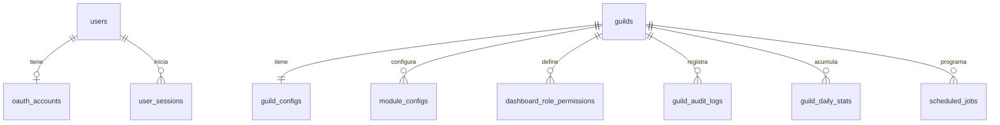

# NEXUS BOT — Especificación de la base de datos

Motor: **PostgreSQL 18**. Acceso: SQLAlchemy 2 async + asyncpg. Migraciones: Alembic.

URL de conexión (en `.env`):

```text
DATABASE_URL=postgresql://nexus:<contraseña>@127.0.0.1:5432/nexus
```

SQLAlchemy la usa como `postgresql+asyncpg://…` (el código hace el cambio de prefijo).

---

## 1. Convenciones

| Regla | Detalle |
|---|---|
| Nombres | `snake_case`, tablas en plural (`guilds`, `module_configs`) |
| IDs de Discord | `BIGINT`. Los snowflakes caben en un entero de 64 bits y ocupan la mitad que un texto, con índices más rápidos. **En la API se envían como texto** (`"123456789012345678"`) porque JavaScript pierde precisión con enteros tan grandes. |
| IDs propios | `BIGINT GENERATED ALWAYS AS IDENTITY`, salvo sesiones (`UUID`) |
| Fechas | Siempre `TIMESTAMPTZ` guardado en UTC. La zona horaria del servidor solo se usa para mostrar y para calcular repeticiones. |
| Colores | `INTEGER` (formato de Discord, `0x7465F7`). El dashboard convierte a `#7465F7`. |
| Borrado | `ON DELETE CASCADE` desde `guilds` y `users`. Sin "borrado lógico" salvo donde se indica. |
| Configuración de módulos | `JSONB` validado **siempre** por un esquema Pydantic antes de guardar. La base de datos nunca recibe JSON sin validar. |
| Concurrencia | Las filas editables desde el dashboard tienen `version INTEGER`. Cada guardado envía la versión que leyó; si no coincide, la API responde `409` (dos admins editando a la vez). |
| Índices | `ix_<tabla>_<columnas>`; únicos `uq_<tabla>_<columnas>` |
| Secretos | Tokens de OAuth e integraciones se guardan **cifrados** (`BYTEA`, Fernet con `ENCRYPTION_KEY`). Nunca en texto plano. |

---

## 2. Tablas de la V1

Diagrama de relaciones:



### 2.1. `users` — personas que entran al dashboard

| Columna | Tipo | Nulo | Defecto | Notas |
|---|---|---|---|---|
| `id` | BIGINT | no | — | **PK.** ID de Discord del usuario |
| `username` | TEXT | no | — | |
| `global_name` | TEXT | sí | | Nombre visible |
| `avatar` | TEXT | sí | | Hash del avatar |
| `locale` | TEXT | no | `'es'` | `es` / `en`. Idioma del dashboard |
| `timezone` | TEXT | no | `'UTC'` | Nombre IANA (`America/Mexico_City`) |
| `created_at` | TIMESTAMPTZ | no | `now()` | |
| `updated_at` | TIMESTAMPTZ | no | `now()` | |
| `last_login_at` | TIMESTAMPTZ | sí | | |

Restricciones: `CHECK (locale IN ('es','en'))`.

### 2.2. `oauth_accounts` — tokens de Discord del usuario

Se necesitan para pedir a Discord la lista de servidores del usuario (`/users/@me/guilds`).

| Columna | Tipo | Nulo | Notas |
|---|---|---|---|
| `user_id` | BIGINT | no | **PK**, FK → `users.id` ON DELETE CASCADE |
| `access_token_enc` | BYTEA | no | Cifrado |
| `refresh_token_enc` | BYTEA | no | Cifrado |
| `scopes` | TEXT[] | no | `{identify,guilds}` |
| `expires_at` | TIMESTAMPTZ | no | Se renueva automáticamente con el refresh token |
| `updated_at` | TIMESTAMPTZ | no | |

### 2.3. `user_sessions` — sesiones del dashboard

La cookie del navegador lleva un token aleatorio. En la base de datos solo se guarda su **hash SHA-256**: si alguien roba la base de datos, no puede usar las sesiones.

| Columna | Tipo | Nulo | Defecto | Notas |
|---|---|---|---|---|
| `id` | UUID | no | `gen_random_uuid()` | PK |
| `user_id` | BIGINT | no | | FK → `users.id` CASCADE |
| `token_hash` | BYTEA | no | | `uq_user_sessions_token_hash` |
| `created_at` | TIMESTAMPTZ | no | `now()` | |
| `last_seen_at` | TIMESTAMPTZ | no | `now()` | Se actualiza como máximo una vez por minuto |
| `expires_at` | TIMESTAMPTZ | no | | 30 días; se extiende con el uso |
| `revoked_at` | TIMESTAMPTZ | sí | | Logout o "cerrar todas las sesiones" |
| `ip` | INET | sí | | Para la página Security de la cuenta |
| `user_agent` | TEXT | sí | | |

Índices: `ix_user_sessions_user_id`, `ix_user_sessions_expires_at`.

### 2.4. `guilds` — servidores de Discord conocidos

Se crea una fila cuando el bot entra a un servidor **o** cuando un admin abre un servidor en el dashboard.

| Columna | Tipo | Nulo | Defecto | Notas |
|---|---|---|---|---|
| `id` | BIGINT | no | | **PK.** ID de Discord del servidor |
| `name` | TEXT | no | | |
| `icon` | TEXT | sí | | Hash del icono |
| `owner_id` | BIGINT | no | | |
| `member_count` | INTEGER | no | `0` | Lo actualiza el bot |
| `bot_present` | BOOLEAN | no | `false` | ¿Está el bot dentro ahora? |
| `bot_joined_at` | TIMESTAMPTZ | sí | | |
| `bot_left_at` | TIMESTAMPTZ | sí | | Inicia el plazo de borrado de datos (ver §5) |
| `created_at` | TIMESTAMPTZ | no | `now()` | |
| `updated_at` | TIMESTAMPTZ | no | `now()` | |

Índice parcial: `ix_guilds_bot_left_at` sobre `bot_left_at` `WHERE bot_present = false`.

### 2.5. `guild_configs` — configuración general del servidor

Una fila por servidor, creada junto con `guilds`.

| Columna | Tipo | Nulo | Defecto | Notas |
|---|---|---|---|---|
| `guild_id` | BIGINT | no | | **PK**, FK → `guilds.id` CASCADE |
| `locale` | TEXT | no | `'es'` | Idioma de los mensajes del bot en este servidor |
| `timezone` | TEXT | no | `'UTC'` | Para mensajes programados y fechas |
| `embed_color` | INTEGER | no | `7628279` | `#7465F7`, color por defecto de los embeds |
| `version` | INTEGER | no | `1` | Concurrencia optimista |
| `updated_at` | TIMESTAMPTZ | no | `now()` | |
| `updated_by` | BIGINT | sí | | ID del usuario que guardó |

### 2.6. `module_configs` — configuración de cada módulo

El núcleo del sistema modular. Una fila por (servidor, módulo). Si no existe la fila, el módulo está desactivado y usa los valores por defecto de su esquema.

| Columna | Tipo | Nulo | Defecto | Notas |
|---|---|---|---|---|
| `guild_id` | BIGINT | no | | FK → `guilds.id` CASCADE |
| `module` | TEXT | no | | `welcome`, `automod`, `logging`… |
| `enabled` | BOOLEAN | no | `false` | Interruptor general del módulo |
| `config` | JSONB | no | `'{}'` | Validado con el esquema Pydantic del módulo |
| `schema_version` | SMALLINT | no | `1` | Para migrar el JSON si el esquema cambia |
| `version` | INTEGER | no | `1` | Concurrencia optimista |
| `updated_at` | TIMESTAMPTZ | no | `now()` | |
| `updated_by` | BIGINT | sí | | |

- PK: `(guild_id, module)`.
- `CHECK (module ~ '^[a-z][a-z_]{1,31}$')`. La lista de módulos válidos vive en el código (`nexus_core.modules.REGISTRY`), no en la base de datos, para poder añadir módulos sin migraciones.
- Desactivar un módulo **no borra** su `config`.

### 2.7. `dashboard_role_permissions` — quién del staff puede usar el dashboard

En V1 solo pueden entrar quienes tengan **Administrar servidor** o **Administrador** en Discord (o el dueño). La tabla se crea en V1, pero su página de configuración llega en la fase 3.

| Columna | Tipo | Nulo | Notas |
|---|---|---|---|
| `guild_id` | BIGINT | no | FK → `guilds.id` CASCADE |
| `role_id` | BIGINT | no | Rol de Discord |
| `module` | TEXT | no | Nombre del módulo, o `*` para todos |
| `level` | SMALLINT | no | `1` = ver, `2` = editar, `3` = administrar (activar/desactivar, borrar) |

PK: `(guild_id, role_id, module)`. `CHECK (level BETWEEN 1 AND 3)`.

### 2.8. `guild_audit_logs` — historial de cambios

Registra cada cambio hecho desde el dashboard o por el sistema. Es la página **Audit History** y la sección "Actividad reciente" del Overview.

| Columna | Tipo | Nulo | Defecto | Notas |
|---|---|---|---|---|
| `id` | BIGINT IDENTITY | no | | PK |
| `guild_id` | BIGINT | no | | FK → `guilds.id` CASCADE |
| `actor_id` | BIGINT | sí | | `NULL` = el sistema |
| `source` | TEXT | no | | `dashboard`, `bot`, `system` |
| `action` | TEXT | no | | `module.update`, `module.enable`, `module.disable`, `settings.update`, `welcome.test_sent`… |
| `module` | TEXT | sí | | |
| `changes` | JSONB | sí | | Solo las claves que cambiaron: `{"join.channel_id": {"old": "1", "new": "2"}}` |
| `created_at` | TIMESTAMPTZ | no | `now()` | |

Índice: `ix_guild_audit_logs_guild_id_created_at` sobre `(guild_id, created_at DESC)`.

### 2.9. `guild_daily_stats` — estadísticas por día

Alimenta las tarjetas y gráficas del Overview. El bot hace `INSERT … ON CONFLICT DO UPDATE SET x = x + 1`. Para no escribir en cada evento, acumula en memoria y vuelca cada 60 segundos.

| Columna | Tipo | Nulo | Defecto | Notas |
|---|---|---|---|---|
| `guild_id` | BIGINT | no | | FK → `guilds.id` CASCADE |
| `day` | DATE | no | | Día en UTC |
| `members_joined` | INTEGER | no | `0` | |
| `members_left` | INTEGER | no | `0` | |
| `commands_used` | INTEGER | no | `0` | |
| `welcome_sent` | INTEGER | no | `0` | |
| `mod_actions` | INTEGER | no | `0` | Se usa desde la fase 3 |

PK: `(guild_id, day)`. Se añaden columnas según lleguen módulos nuevos.

### 2.10. `scheduled_jobs` — tareas persistentes

Para todo lo que debe ocurrir en el futuro: mensajes programados, fin de sorteos, cierre automático de tickets, fin de timeouts temporales, borrado de datos. Si el bot se reinicia, las tareas siguen ahí.

| Columna | Tipo | Nulo | Defecto | Notas |
|---|---|---|---|---|
| `id` | BIGINT IDENTITY | no | | PK |
| `guild_id` | BIGINT | sí | | FK → `guilds.id` CASCADE. `NULL` = tarea global |
| `job_type` | TEXT | no | | `guild.purge`, `scheduled_message.send`, `giveaway.end`… |
| `payload` | JSONB | no | `'{}'` | Datos que necesita la tarea |
| `run_at` | TIMESTAMPTZ | no | | Cuándo ejecutar (UTC) |
| `status` | TEXT | no | `'pending'` | `pending`, `running`, `done`, `failed`, `cancelled` |
| `attempts` | SMALLINT | no | `0` | |
| `max_attempts` | SMALLINT | no | `5` | |
| `locked_by` | TEXT | sí | | Identificador del worker |
| `locked_at` | TIMESTAMPTZ | sí | | |
| `last_error` | TEXT | sí | | |
| `dedupe_key` | TEXT | sí | | Evita duplicados (`giveaway.end:123`) |
| `created_at` | TIMESTAMPTZ | no | `now()` | |
| `completed_at` | TIMESTAMPTZ | sí | | |

- `uq_scheduled_jobs_dedupe_key` (único, ignora `NULL`).
- Índice parcial `ix_scheduled_jobs_due` sobre `run_at` `WHERE status = 'pending'`.
- `CHECK (status IN ('pending','running','done','failed','cancelled'))`.

**Cómo toma tareas el worker** (cada 5 segundos), sin que dos workers ejecuten la misma:

```sql
UPDATE scheduled_jobs SET status = 'running', locked_by = :worker, locked_at = now(),
       attempts = attempts + 1
WHERE id IN (
  SELECT id FROM scheduled_jobs
  WHERE status = 'pending' AND run_at <= now()
  ORDER BY run_at
  LIMIT 20
  FOR UPDATE SKIP LOCKED
)
RETURNING *;
```

- Si termina bien, pasa a `done`.
- Si falla, vuelve a `pending` con `run_at = now() + 2^attempts minutos`, o pasa a `failed` al llegar a `max_attempts`.
- Si una tarea lleva más de 10 minutos en `running` (el worker murió), vuelve a `pending`.
- Las tareas repetitivas (cada día a las 9:00) crean su siguiente ejecución al terminar, calculada con la `timezone` del servidor.

---

## 3. Configuración JSON de los módulos (V1)

### 3.1. `MessageTemplate` — formato común de mensajes

Lo usan Welcome, Goodbye y, más adelante, tickets, sugerencias, mensajes programados, notificaciones y comandos personalizados. Es el modelo del **Embed Builder**.

```jsonc
{
  "content": "¡Bienvenido {user}!",        // texto normal, máx. 2000 caracteres
  "embeds": [                               // V1: máximo 1 embed (Discord permite 10)
    {
      "title": "¡Bienvenido a {server}!",  // máx. 256
      "description": "Ya somos {member_count} miembros.", // máx. 4096
      "url": null,
      "color": 7628279,                     // null = color del servidor
      "author": { "name": null, "icon_url": null, "url": null },     // name máx. 256
      "thumbnail_url": "{user.avatar}",
      "image_url": null,
      "footer": { "text": "NEXUS BOT", "icon_url": null },          // text máx. 2048
      "timestamp": true,
      "fields": [                           // máx. 25
        { "name": "Reglas", "value": "Lee #reglas", "inline": false } // 256 / 1024
      ]
    }
  ]
}
```

Validaciones, que se hacen **después** de sustituir las variables con valores de ejemplo de longitud máxima:

- Debe haber `content` o al menos un embed con contenido.
- Suma de caracteres de todos los embeds ≤ 6000 (límite de Discord).
- Las URLs deben ser `https://` o una variable que produzca una URL.

### 3.2. Variables

Sintaxis única para todo el bot: `{nombre}` o `{nombre.propiedad}`. Una variable desconocida se deja tal cual y el dashboard la marca en rojo.

| Variable | Resultado | Ejemplo |
|---|---|---|
| `{user}` | Mención | `@Alex` |
| `{user.name}` | Nombre de usuario | `alex` |
| `{user.display_name}` | Nombre visible en el servidor | `Alex ✨` |
| `{user.id}` | ID | `123456789012345678` |
| `{user.avatar}` | URL del avatar | `https://cdn.discordapp.com/…` |
| `{user.created_at}` | Fecha de creación de la cuenta | `12 mar 2021` |
| `{user.joined_at}` | Fecha de entrada al servidor | `16 nov 2026` |
| `{server}` | Nombre del servidor | `Mi Comunidad` |
| `{server.id}` | ID del servidor | |
| `{server.icon}` | URL del icono | |
| `{member_count}` | Número de miembros | `12841` |
| `{member_count.ordinal}` | Número ordinal según el idioma | `12841.º` / `12841st` |
| `{channel}` | Mención del canal de destino | `#bienvenida` |

Las fechas se formatean según el `locale` y la `timezone` de `guild_configs`.

### 3.3. Módulo `welcome`

```jsonc
{
  "join": {
    "enabled": true,
    "channel_id": "987654321098765432",   // texto (ver convenciones); null = sin canal
    "ignore_bots": true,
    "message": { /* MessageTemplate */ },
    "dm": {
      "enabled": false,
      "message": { /* MessageTemplate */ }
    },
    "delete_after_seconds": null           // null o 5..86400
  },
  "leave": {
    "enabled": false,
    "channel_id": null,
    "ignore_bots": true,
    "message": { /* MessageTemplate */ }
  }
}
```

- `module_configs.enabled` es el interruptor general; `join.enabled` y `leave.enabled` son los de cada parte.
- Si `join.enabled = true`, `channel_id` es obligatorio.
- Valores por defecto: los define el esquema Pydantic en el idioma del servidor ("¡Bienvenido {user} a **{server}**!").
- Fases posteriores: mensajes aleatorios, condiciones por rol e imagen de bienvenida generada.

### 3.4. Esquema Pydantic (referencia)

```python
class WelcomeJoin(BaseModel):
    enabled: bool = True
    channel_id: Snowflake | None = None
    ignore_bots: bool = True
    message: MessageTemplate = Field(default_factory=default_join_message)
    dm: WelcomeDM = Field(default_factory=WelcomeDM)
    delete_after_seconds: int | None = Field(None, ge=5, le=86400)

    @model_validator(mode="after")
    def channel_required(self):
        if self.enabled and self.channel_id is None:
            raise ValueError("channel_required")
        return self
```

`Snowflake` es un tipo propio que acepta texto de dígitos, lo guarda como `int` y lo serializa como texto.

---

## 4. Tablas de fases posteriores (referencia)

No se crean hasta que llegue su fase. Comparado con la lista de ChatGPT, se **fusionan o eliminan** tablas que duplicaban información:

- `moderation_bans`, `moderation_timeouts` y `moderation_warnings` → una sola `moderation_cases` con `action` y `expires_at`.
- `reaction_role_assignments` → no hace falta: Discord ya guarda qué roles tiene cada miembro.
- `starboard_reactions` → no hace falta: el número de reacciones se lee del mensaje.
- `integration_secrets` → columna cifrada dentro de `integrations`.
- `guild_hourly_stats`, `module_usage_stats` → columnas de `guild_daily_stats`.
- `template_modules` → JSONB dentro de `guild_templates`.

### Fase 3 — Moderación, AutoMod, logs

| Tabla | Columnas clave |
|---|---|
| `moderation_cases` | `id`, `guild_id`, `case_number` (único por servidor), `target_id`, `moderator_id`, `action` (`warn`,`timeout`,`kick`,`ban`,`unban`,`note`), `reason`, `expires_at`, `active`, `source` (`manual`,`automod`,`ai`), `created_at` |
| `automod_rules` | `id`, `guild_id`, `name`, `enabled`, `rule_type`, `config` JSONB, `actions` JSONB, `exempt_role_ids` BIGINT[], `exempt_channel_ids` BIGINT[], `priority`, `test_mode`, `version` |
| `automod_events` | `id`, `guild_id`, `rule_id`, `user_id`, `channel_id`, `action_taken`, `excerpt` (máx. 200 caracteres), `created_at`. Retención: 30 días |
| Módulo `logging` | Solo `module_configs`: canal por categoría de eventos |

### Fase 4 — Roles y miembros

| Tabla | Columnas clave |
|---|---|
| Módulo `autoroles` | Solo `module_configs` (roles al entrar, roles de bots, retraso) |
| `role_panels` | `id`, `guild_id`, `channel_id`, `message_id`, `panel_type` (`buttons`,`select`,`reactions`), `message` (MessageTemplate), `mode` (`normal`,`unique`,`verify`,`drop`), `max_choices`, `version` |
| `role_panel_options` | `id`, `panel_id`, `role_id`, `label`, `emoji`, `description`, `position` |
| `member_notes` | `id`, `guild_id`, `user_id`, `author_id`, `note`, `created_at` |

### Fase 5 — Comunidad

| Tabla | Columnas clave |
|---|---|
| `ticket_panels` | `id`, `guild_id`, `channel_id`, `message_id`, `message`, `category_channel_id`, `support_role_ids`, `max_open_per_user`, `auto_close_hours` |
| `tickets` | `id`, `guild_id`, `panel_id`, `number`, `creator_id`, `channel_id`, `status`, `claimed_by`, `opened_at`, `closed_at`, `closed_by`, `close_reason` |
| `ticket_transcripts` | `ticket_id`, `storage_path` (archivo HTML), `message_count`, `created_at`. Retención configurable |
| `suggestions` | `id`, `guild_id`, `number`, `author_id`, `message_id`, `content`, `status`, `upvotes`, `downvotes`, `staff_response`, `created_at` |
| `suggestion_votes` | `suggestion_id`, `user_id`, `vote` (+1 / -1) — PK compuesta |
| `suggestion_status_history` | `id`, `suggestion_id`, `status`, `changed_by`, `reason`, `created_at` |
| `polls` | `id`, `guild_id`, `channel_id`, `message_id`, `question`, `multiple`, `ends_at`, `closed` |
| `poll_options` / `poll_votes` | opciones y votos (PK `poll_id, user_id, option_id`) |
| `giveaways` | `id`, `guild_id`, `channel_id`, `message_id`, `prize`, `winner_count`, `requirements` JSONB, `ends_at`, `ended`, `seed` (para que el sorteo sea verificable) |
| `giveaway_entries` / `giveaway_winners` | PK `(giveaway_id, user_id)` |
| `starboard_entries` | `guild_id`, `source_message_id`, `starboard_message_id`, `star_count` |

### Fase 6 — Niveles y economía

| Tabla | Columnas clave |
|---|---|
| `member_xp` | PK `(guild_id, user_id)`, `xp`, `level`, `message_count`, `last_xp_at`. Índice `(guild_id, xp DESC)` para el ranking |
| `level_rewards` | `guild_id`, `level`, `role_id`, `remove_previous` |
| `rank_card_designs` | `guild_id`, `design` JSONB |
| `member_wallets` | PK `(guild_id, user_id)`, `balance` BIGINT `CHECK (balance >= 0)`, `bank` |
| `economy_transactions` | `id`, `guild_id`, `user_id`, `amount`, `kind`, `reference`, `created_at` (registro inmutable) |
| `economy_items` | `id`, `guild_id`, `name`, `price`, `stock`, `role_id`, `enabled` |
| `economy_inventory` | PK `(guild_id, user_id, item_id)`, `quantity` |

Las transferencias de saldo se hacen en una transacción con `SELECT … FOR UPDATE` para evitar saldos negativos o duplicados. Puntos virtuales sin valor real: sin compras con dinero, sin casino.

### Fase 7 — Integraciones e IA

| Tabla | Columnas clave |
|---|---|
| `integrations` | `id`, `guild_id`, `provider` (`youtube`,`twitch`,`rss`,`github`), `external_id`, `channel_id`, `message` (MessageTemplate), `enabled`, `secret_enc` BYTEA, `last_event_at`, `status` |
| `integration_deliveries` | `id`, `integration_id`, `external_event_id` (único: evita avisos duplicados), `status`, `error`, `created_at`. Retención: 30 días |
| `ai_moderation_events` | `id`, `guild_id`, `message_id`, `user_id`, `category`, `score`, `action`, `reviewed_by`, `review_result`, `created_at`. **No se guarda el texto completo del mensaje.** |
| `ai_usage` | PK `(guild_id, month)`, `tokens_used`, `requests` — para límites por plan |

### Fase 8 — Premium, plantillas, notificaciones

| Tabla | Columnas clave |
|---|---|
| `premium_subscriptions` | `id`, `user_id`, `guild_id`, `plan`, `provider`, `external_id`, `status`, `current_period_end` |
| `guild_templates` | `id`, `owner_id`, `name`, `is_public`, `modules` JSONB |
| `user_notifications` | `id`, `user_id`, `guild_id`, `type`, `data` JSONB, `read_at`, `created_at` |
| `feature_flags` | `key`, `enabled`, `guild_ids` BIGINT[] |

---

## 5. Retención y borrado de datos

Esto se refleja después en la Política de privacidad (`/legal/privacy`).

| Dato | Se conserva | Cómo se borra |
|---|---|---|
| Configuración de un servidor | Mientras el bot esté dentro | 30 días después de `bot_left_at`, tarea `guild.purge` (se cancela si el bot vuelve antes) |
| `guild_audit_logs` | 180 días | Tarea diaria `system.cleanup` |
| `user_sessions` caducadas | 7 días tras `expires_at` | Tarea diaria |
| `automod_events`, `integration_deliveries` | 30 días | Tarea diaria |
| Contenido de mensajes (logs de editados/borrados) | **No se guarda en la base de datos.** Se envía al canal de logs del servidor y se descarta. | — |
| Cuenta de usuario | Hasta que la borre | `/account` → "Eliminar mis datos" borra `users` en cascada |

## 6. Migraciones

- Alembic, carpeta `migrations/` en la raíz y `alembic.ini` apuntando a `nexus_core.db.models`.
- Una migración por cambio, con nombre descriptivo (`0002_welcome_stats.py`).
- Las migraciones de V1 crean las 10 tablas de la §2.
- Si cambia el esquema JSON de un módulo, se sube su `schema_version` y el código migra el JSON al leerlo (función `upgrade_config(old_version, data)` en el esquema del módulo).
- Copias de seguridad: en local, `pg_dump` manual. En producción, `pg_dump` diario con 14 días de retención (fase 9).
